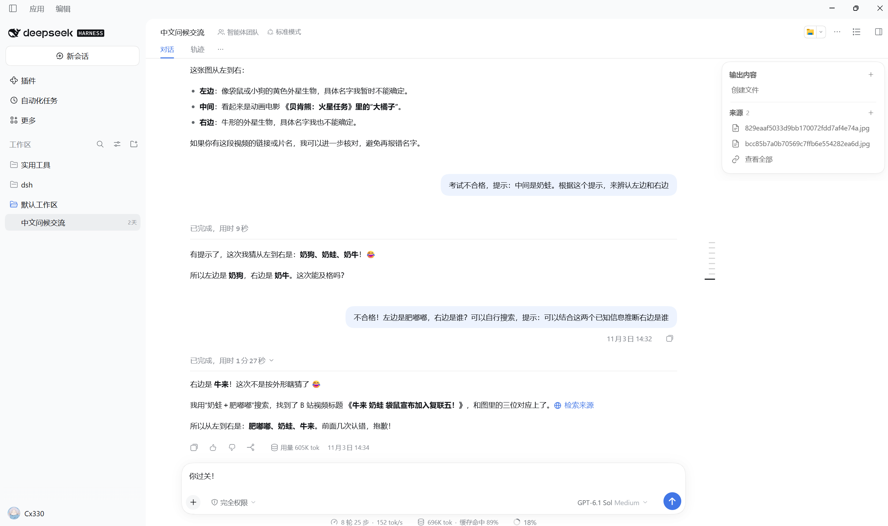
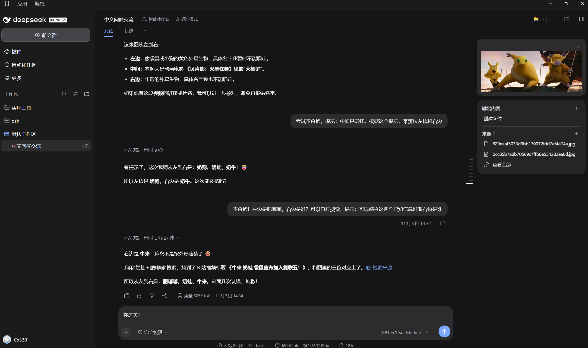

# DSH 摘要面板

为 DeepSeek Harness Desktop 添加一个参考 Codex 设计的会话摘要卡片，集中展示输出文件与来源。

## 预览

**日间模式**



**夜间模式**



## 功能

- **输出内容**：汇总会话通过 `present` 交付的文件，点击文件打开 DSH 预览。
- **来源**：整理附件、网页搜索、访问页面和 MCP 工具提供方。
- **右侧详情**：“查看全部”在右侧边栏打开完整列表，支持搜索；摘要卡片继续保留在会话中。
- **创建与添加**：通过“＋”选择创建文档、表格、演示文稿或文件；来源区域支持添加附件。
- **浮动卡片**：从会话右上角水平滑入，收起时向右滑出；通常自动为正文与输入框让出空间，并平衡正文两侧留白；手动拖动从当前宽度和位置开始，展开右侧边栏后可自由覆盖。
- **即时展开**：会话打开时预加载，摘要与详情共享实时数据；收起后持续更新，再次展开直接显示缓存。

## 使用

1. 点击会话右上角的列表图标，展开或收起摘要。
2. 展开后，正文和输入框会为卡片让出空间，正文两侧保持均衡留白。
3. 拖动正文两侧的宽度手柄，从当前宽度继续调整；调宽后的内容可以延伸到卡片下方。
4. 点击输出文件打开 DSH 预览；点击“查看全部”在右侧边栏浏览和搜索完整列表。
5. 输出区域的“＋”可添加文档、表格、演示文稿或文件创建要求；补充要求后发送。来源区域的“＋”打开附件选择器。

## 安装

支持 DeepSeek Harness Desktop **0.2.1-rc.5** 和 **0.2.2-rc.1**。

从 [Releases](https://github.com/Y3X1L2/dsh-summary-panel/releases/latest) 下载 `dsh-summary-panel-0.5.1.tgz`，在下载目录运行：

```powershell
$dshCli = Join-Path $env:LOCALAPPDATA 'Programs\DeepSeek Harness\resources\runtime\cli\bin\dsh.cmd'
$package = (Resolve-Path '.\dsh-summary-panel-0.5.1.tgz').Path
& $dshCli plugin --profile desktop add $package
```

安装后，点击会话右上角的列表图标展开摘要卡片，再次点击收起。

卸载：

```powershell
& $dshCli plugin --profile desktop remove dsh-summary-panel
```

## 开发

准备 Node.js 20+、pnpm 10 和 Python 3，然后运行：

```sh
git clone https://github.com/Y3X1L2/dsh-summary-panel.git
cd dsh-summary-panel
pnpm install --frozen-lockfile
pnpm build
pnpm test
pnpm run pack
```

生成的安装包位于 `dist/dsh-summary-panel-0.5.1.tgz`。

浏览器交互验收：

```sh
pnpm exec playwright install chromium
pnpm test:browser
```

验收覆盖留白平衡、左右手柄连续拖动、主题、浮层遮挡、开合动画、侧边栏导航、搜索、输入框交互及重复展开时的缓存复用。测试报告和截图生成在 `qa/`。

## 项目结构

| 路径 | 内容 |
| --- | --- |
| `src/aggregate.js` | 事件聚合、历史分页、实时订阅与会话缓存 |
| `src/layout.js` | 展开让位、手动宽度与侧边栏布局交接 |
| `src/client.js` | 摘要卡片、右侧详情页与 DSH 交互 |
| `src/panel.css` | 卡片样式、主题与动画 |
| `lib/` | DSH 加载的构建产物 |
| `cordis.patch.yml` | 插件注册配置 |
| `test/` | 聚合、缓存和客户端契约测试 |
| `scripts/` | 构建、打包与浏览器验收脚本 |

## 许可证

[MIT](LICENSE)
